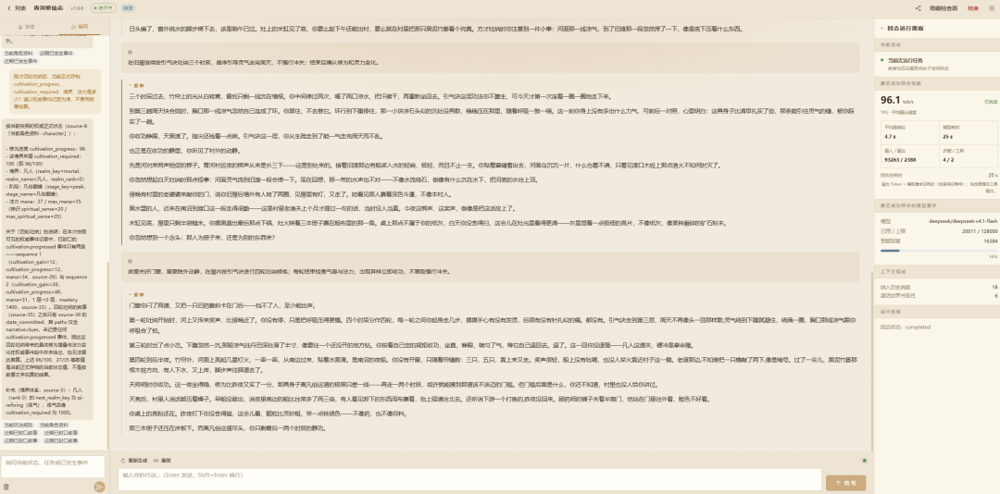
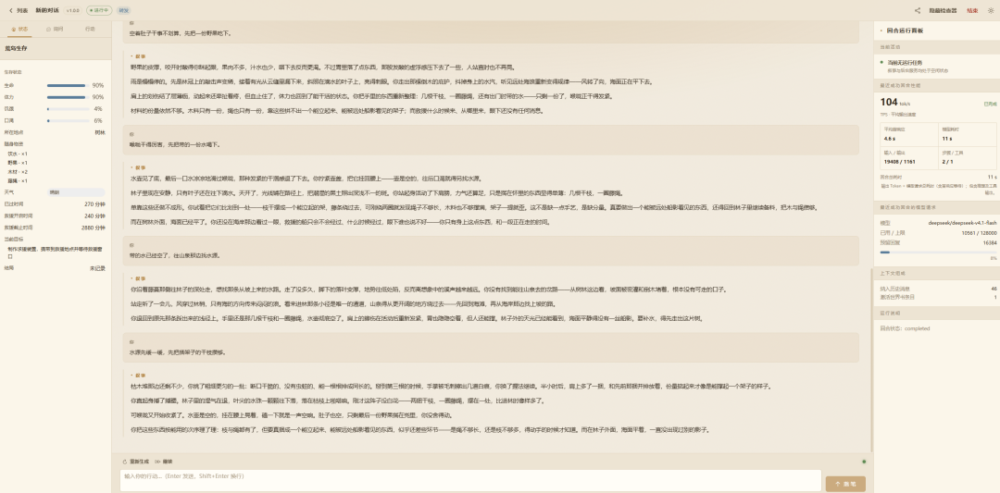
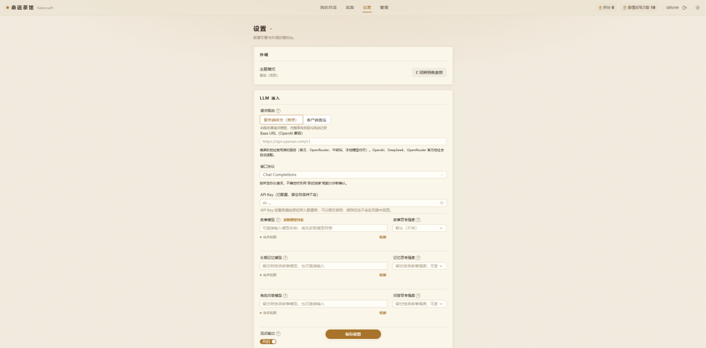
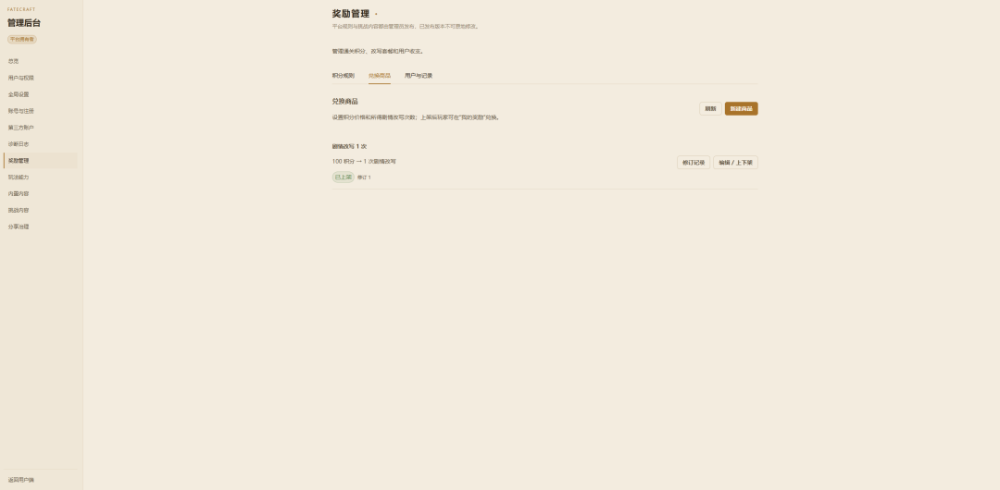
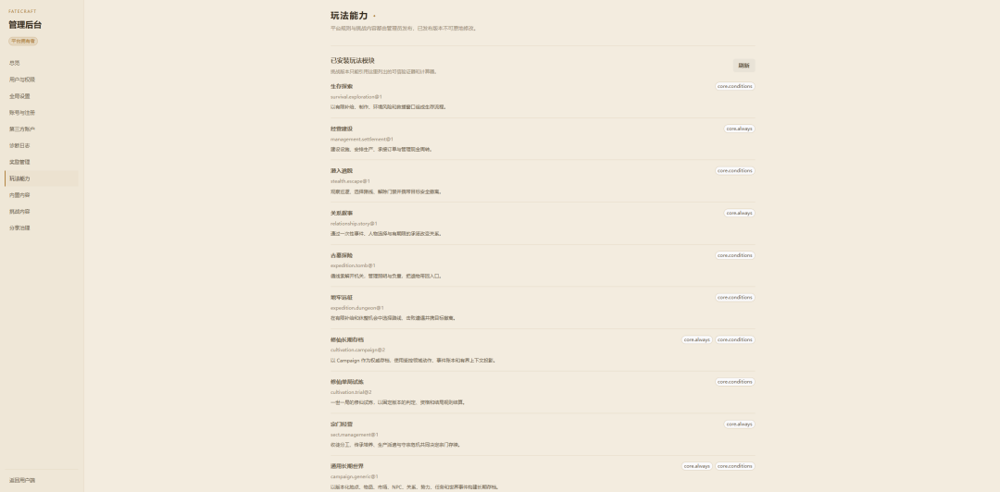
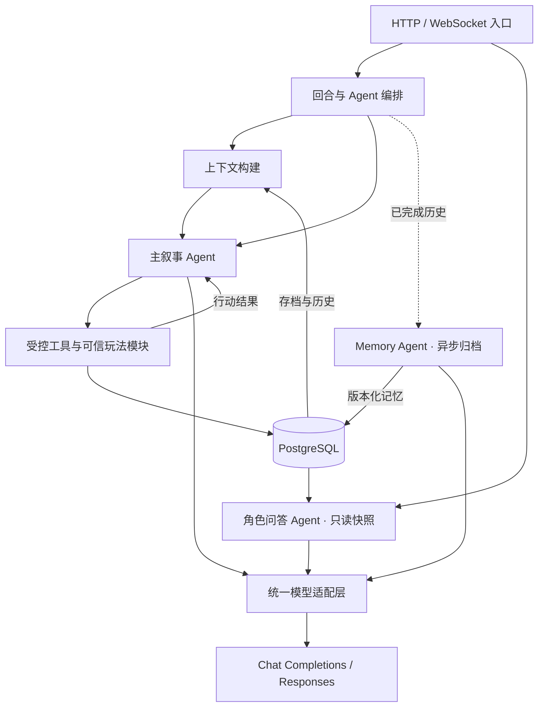

# fateCraft 命运酒馆

**Web 休闲文字冒险酒馆。** 选择一个故事，成为其中的角色，用自己的行动决定接下来发生什么。

命运酒馆是一个开源、可自部署的 AI 文字冒险平台。玩家用自然语言行动，由 AI 推进叙事；玩法规则、角色状态、判定和结局由服务端管理，让每局故事既能自由发展，也有可验证的结果。

## 玩法

玩家选择玩法、身份和开局场景后开始一段独立冒险。你可以自由描述行动，和角色交谈、调查地点、完成任务、管理资源，或尝试玩法提供的其他行动。AI 会结合当前故事和存档继续叙事；涉及判定和状态变化时，服务端依据当前玩法规则验证并记录结果。

目前平台围绕八种题材方向提供玩法：

- 修仙飞升、宗门经营
- 生存探索、经营建设
- 潜入逃脱、关系叙事
- 古墓探险、地牢远征

故事既可以是一局有明确目标和结局的挑战，也可以是一份持续成长的长期存档。对话之间的角色状态、历史、记忆与结算互相隔离；长期游戏还会在后台整理历史，方便继续游玩。

### 内置玩法

仓库附带九个可导入的玩法包，涵盖上述八种方向。两个修仙玩法共享基础设定，其他题材提供可游玩的示例：

| 玩法       | 类型     | 体验                                                                 |
| ---------- | -------- | -------------------------------------------------------------------- |
| 青河修仙志 | 修仙飞升 | 从青河村起步，修炼、探索、交易、做任务，与角色和势力共同经历长期变化 |
| 百年飞升劫 | 修仙飞升 | 在寿元压力下积累资源、逐级突破，并选择不同的飞升路线                 |
| 青岚宗重建 | 宗门经营 | 经营宗门，在发展与生存之间作出选择                                   |
| 荒岛求援   | 生存探索 | 在孤岛上寻找资源、应对危险并设法获救                                 |
| 山间客栈   | 经营建设 | 经营客栈，应对日常事务与来客故事                                     |
| 夜入封锁区 | 潜入逃脱 | 在封锁区域中搜集线索、规避威胁并寻找出口                             |
| 小镇旧约   | 关系叙事 | 在小镇的人际关系与旧日秘密中作出选择                                 |
| 失落墓室   | 古墓探险 | 探索墓室、处理机关并寻找遗迹中的答案                                 |
| 地下哨塔   | 地牢远征 | 深入危险区域，在有限资源下推进探索                                   |

## 核心功能

- **自由叙事与可信存档**：玩家可以自由描述行动；AI 负责理解和讲述，服务端负责判定、状态变更、资源消耗、结局与奖励。
- **单局挑战与长期冒险**：支持有明确胜负目标的短局，也支持拥有角色、地点、任务、物品、市场和势力的长期 Campaign。
- **玩法包与版本管理**：管理员可以创建、校验和发布玩法，也可以导入、导出玩法包，便于备份、分享和创作新内容。
- **通关奖励与积分兑换**：玩法可以为阶段和结局配置积分奖励；玩家可用积分兑换剧情改写次数或 CDK 商品（逐份库存、每人限额、售后工单退款），也可输入积分 CDK 领取积分；管理员可查询用户并发放积分或奖励。
- **长期记忆与角色问答**：后台异步整理较早的对话历史；角色面板可基于当前存档回答问题，不会修改游戏事实。
- **模型访问方式**：服务端转发适合需要可信结算和奖励的游玩；客户端直连适合希望使用自己的模型配置、由浏览器直接请求模型服务的玩家。
- **可选服务端出站代理**：owner 可让后端模型请求统一走 HTTP/HTTPS 代理，适合服务器访问模型网络受限的部署；只覆盖服务端模型流量，不影响客户端直连、网站 API、WebSocket、数据库或邮件。
- **账号与管理后台**：支持本地账号、LinuxDo Connect 和可配置的邮箱注册，提供用户、玩法、奖励、模型与诊断管理。

### 客户端直连与服务端转发

两种模式的请求路径和奖励资格不同，请按自己的需要选择：

| 模式       | 请求路径                                        | API Key 保存位置                                    | 奖励与额度                                       |
| ---------- | ----------------------------------------------- | --------------------------------------------------- | ------------------------------------------------ |
| 客户端直连 | 浏览器直接连接你配置的模型服务                  | 保存在当前浏览器设备；服务端不接收或保存            | 可以游玩，但不发放账号奖励，也不扣除剧情改写次数 |
| 服务端转发 | 浏览器请求 fateCraft 后端，再由后端请求模型服务 | 写入数据库前使用 AES-GCM 加密；服务端运行时解密使用 | 支持可信结算、账号奖励与平台额度                 |

客户端直连让模型密钥留在本设备，并使用本机网络访问模型服务；后端仍负责上下文构建、对话存档与玩法校验。由于浏览器回传的模型响应可能被修改，直连模式不发放奖励。服务端转发模式由后端直接接收模型响应，用户密钥在数据库中加密保存。两种模式下，所选模型服务都会收到生成所需的提示词和对话内容。

服务端转发还可以由 owner 在“全局设置 → LLM 出站代理”配置统一 HTTP/HTTPS 出口。默认停用，停用时后端模型请求严格直连并忽略 `HTTP_PROXY`、`HTTPS_PROXY`、`NO_PROXY`；启用后固定走保存的代理，不因 `NO_PROXY` 绕过，也不会在失败时自动改走直连。代理密码使用 `AUTH_DATA_ENCRYPTION_KEY` 加密保存，可选额外 CA 只作用于 LLM 专用客户端。Docker 部署时代理地址必须从后端容器内可达，容器内的 `127.0.0.1` 指向容器自身；客户端直连仍由浏览器使用本机网络，不经过该代理。

## 界面截图

### 青河修仙志



### 荒岛求援



### 设置



### 管理后台



### 玩法能力



## 项目架构

命运酒馆采用 **职责隔离的 Agent 协作 + 配置驱动的可信玩法模块**。Go 后端以模块化单体组织业务，统一承担模型编排、玩法执行、异步任务与持久化；前端通过 HTTP 与 WebSocket 展示故事、状态和运行进度。

### 前端与模型连接

Vue 前端负责交互和流式展示，两种连接方式共用同一套后端玩法流程：

- **服务端转发**：后端构建模型请求、连接模型服务并处理响应。
- **客户端直连**：后端构建模型请求，通过浏览器 Relay 使用本设备密钥连接模型服务，再将原始响应传回后端处理。后端继续负责协议解析和规则校验，模型密钥留在浏览器。

### 三个 Agent 如何协作

后端统一调度三个职责不同的模型 Agent。它们通过已提交的存档、历史与版本化记忆协作，可以分别配置模型，以平衡叙事质量、响应速度和成本。

| Agent              | 负责什么                           | 如何参与游戏                                                     |
| ------------------ | ---------------------------------- | ---------------------------------------------------------------- |
| **主叙事 Agent**   | 理解行动、调用工具、推进故事       | 在玩家回合中运行 Agent Tool Loop，根据工具返回的真实结果继续叙事 |
| **Memory Agent**   | 提炼历史梗概、人物、线索和重要选择 | 后台按需整理已完成回合，为后续叙事提供长期记忆，不阻塞当前回合   |
| **角色问答 Agent** | 回答状态、任务和已发生事件的问题   | 读取当前存档快照独立回答，不推进主剧情，也不修改玩法状态         |



主叙事采用 **Agent Tool Loop**：构建上下文 → 模型选择文本或工具调用 → 服务端校验并执行工具 → 将执行结果交回模型 → 继续生成，直到完成这一轮回复。每一步只向模型开放当前可用的动作；模型可以提出行动，但状态变化、随机判定、资源消耗和奖励始终由服务端规则决定。

Memory Agent 和角色问答 Agent 使用结构化输出，由后端验证结果。记忆负责保持故事连续性，当前数值和玩法进度仍以存档为准；问答拥有独立的请求和记录，不会占用主叙事的生成锁。

### 上下文编排与模型适配

上下文构建器按 Token 预算组织玩法 Prompt、世界书、近期完整回合、长期记忆与当前可信状态。每次生成固定使用一份已提交记忆，避免后台归档在回合中途改变模型看到的资料；当前状态和行动结果会反馈给叙事 Agent，帮助故事与存档保持一致。

模型适配层统一处理 Chat Completions 与 Responses，将文本流、思考内容、工具调用及结构化结果转换成内部协议。客户端直连和服务端转发共用这一层的解析与校验，玩法模块无需适配具体模型供应商。

### 配置驱动与可信玩法模块

玩法扩展分为内容、规则和平台三层：

| 层次               | 职责                                                           | 主要位置                                                                    |
| ------------------ | -------------------------------------------------------------- | --------------------------------------------------------------------------- |
| **玩法内容包**     | 描述角色、身份、场景、世界书、规则参数、结局和展示布局         | `backend/data/preset_packs/`                                                |
| **可信玩法模块**   | 实现合法行动、资源成本、时间推进、随机事件、状态变化与结局条件 | `backend/internal/gameplay/`                                                |
| **平台服务与编排** | 提供账号、对话、上下文、工具调度、版本管理、存档和奖励结算     | `backend/internal/orchestration/`、`challenge/`、`campaign/`、`storage/` 等 |

同一种玩法规则可以搭配不同内容包，复用出新的世界与故事；需要新增机制时，再扩展对应的 Go 模块。可信模块在构建时注册，导入的内容包只提供配置，不执行上传代码。平台通过统一契约连接不同题材，使修仙、经营、探索等规则各自维护，共享对话、模型、存档和奖励能力。

### 持久化与故障恢复

每个回合记录生成尝试、模型步骤和工具执行结果。写入动作与奖励通过数据库事务提交，请求标识用于防止网络重试造成重复执行；分支和修订校验阻止旧请求覆盖新存档。动作已经成功而叙事中断时，可以基于已提交结果继续叙事。

后台记忆任务使用 PostgreSQL 持久化队列、租约和 Worker 调度，进程重启后可恢复处理。玩法存档、已发布内容和账号账本以 PostgreSQL 为准；模型调用与运行日志为排错提供关联记录。

更完整的实现说明见 [Agent Tool Loop](docs/design/19-agent-tool-loop.md)、[异步记忆与角色问答](docs/design/18-async-memory-character-inquiry.md)和[可信玩法模块架构](docs/design/24-gameplay-module-architecture.md)。

## 自部署

命运酒馆可以运行在自己的电脑、家庭服务器或云服务器上。生产部署提供单一 Docker 镜像和单一容器，容器内包括前端、后端与 PostgreSQL；完整的端口、数据卷、迁移、备份和恢复说明见 [Docker 部署指南](docker/README.md)。

### 环境要求

- Docker Engine 与 Docker Compose 插件
- 若从源码构建：Git、Go 1.27、Node.js 22、pnpm 与 [Go Task](https://taskfile.dev/)

### Docker 部署

正式部署直接拉取 GitHub Container Registry 上的多架构镜像，不需要在服务器安装 Go、Node.js，也不需要本地编译。先准备环境配置：

```bash
cp docker/.env.example docker/.env
cp docker/backend.production.env docker/backend.production.env.local
```

编辑 `docker/.env` 选择要部署的版本，并编辑 `docker/backend.production.env.local` 设置数据库密码、`DATABASE_URL` 以及独立且稳定的 `AUTH_DATA_ENCRYPTION_KEY`、`SHARE_LINK_SIGNING_KEY`（各至少 32 个字符）。镜像版本应使用明确的版本号，例如 `1.0.0`。生产部署应通过 HTTPS 反向代理对外提供服务，切勿提交密钥或密码。

在仓库根目录启动：

```bash
docker compose --env-file docker/.env -f docker/docker-compose.prod.yml pull
docker compose --env-file docker/.env -f docker/docker-compose.prod.yml up -d
```

默认站点入口为 `http://<服务器地址>:8088`。首次打开会进入安装向导，用于创建唯一的站点所有者账号。生产环境请先配置 HTTPS，再开放站点给其他用户使用。

容器启动时会运行数据库迁移。空数据库会导入随镜像发布的内置玩法；已有玩法内容不会被自动覆盖。数据库文件写入独立持久化卷，容器内每日自动备份到 `docker/backups`，默认保留 7 天。若启用 LLM 出站代理，代理地址必须指向后端容器可达的主机端口（例如 Docker Desktop 的 `host.docker.internal` 或 Linux 网桥网关），容器内 `127.0.0.1` 不是宿主机；额外 CA 和加密代理密码随配置保存，备份时必须同时保留稳定的 `AUTH_DATA_ENCRYPTION_KEY`，否则恢复后无法解密。升级、密钥配置及恢复步骤见 [Docker 部署指南](docker/README.md)。

### 本机开发运行

安装 Go、Node.js、pnpm、Go Task 和 PostgreSQL 后，复制并编辑后端配置（pnpm 可用 `corepack enable` 启用）：

```bash
cp backend/.env.example backend/.env
```

配置数据库地址、`ALLOWED_ORIGINS=http://localhost:5173` 及密钥，然后运行迁移并启动后端：

```bash
cd backend
go run ./cmd/migrate up
go run ./cmd/server
```

在另一个终端启动前端：

```bash
cd frontend
pnpm install --frozen-lockfile
pnpm run dev
```

开发地址为 `http://localhost:5173`，后端默认监听 `http://localhost:8081`。Vite 会代理 API 和 WebSocket 请求。后端不会在服务启动时隐式执行数据库迁移；每次升级请先按部署指南检查并执行 migration。

## 首次使用

1. 打开网站并在安装向导中创建站点所有者账号。
2. 在“设置”中选择使用自己的模型，或使用管理员配置的平台模型。
3. 完成模型能力检测，然后从已启用玩法中选择一个身份和开局场景。
4. 在对话中描述行动，查看角色状态、玩法信息和结算结果。

要启用奖励功能，使用服务端转发模式。管理员可以在后台管理玩法结局积分、兑换商品与库存、工单、积分 CDK 和注册赠送规则；积分奖励以服务端结算结果为准。

## 技术栈

| 组件     | 技术                                     |
| -------- | ---------------------------------------- |
| 前端     | Vue 3、TypeScript、Pinia、Naive UI、Vite |
| 后端     | Go、Gin、GORM                            |
| 数据库   | PostgreSQL                               |
| 实时通信 | WebSocket                                |
| 模型接口 | OpenAI 兼容 Chat Completions / Responses |
| 部署     | Docker Compose、Nginx                    |

## 开发与贡献

欢迎反馈问题、提出改进建议，也欢迎制作和分享玩法包。玩法包是数据配置，动作与状态变更只能使用服务端已实现并审核的可信模块，不能通过导入配置执行任意代码。制作说明见[玩法包指南](docs/design/15-challenge-authoring-guide.md)；模块边界见[可信玩法模块架构](docs/design/24-gameplay-module-architecture.md)。

运行本地检查：

```bash
cd backend
go test ./...
go vet ./...
cd ../frontend
pnpm run build
```

涉及数据库变更时，还需使用专用测试数据库运行 PostgreSQL 集成测试，命令和环境变量见[开发验证说明](docs/design/README.md)。请不要提交 `.env` 文件、API Key、SMTP 密码或数据库凭据。

## 设计文档

- [设计文档索引](docs/design/README.md)
- [挑战与玩法包制作指南](docs/design/15-challenge-authoring-guide.md)
- [可信玩法模块架构](docs/design/24-gameplay-module-architecture.md)
- [Agent Tool Loop](docs/design/19-agent-tool-loop.md)
- [积分与奖励管理](docs/design/22-reward-management-and-exchange.md)
- [Docker 部署指南](docker/README.md)

## 项目缘起与致谢

命运酒馆的灵感，来自我在 [Linux DO 社区](https://linux.do/) 体验猫猫头佬创作的[《浮生十梦》](https://github.com/CassiopeiaCode/TenCyclesofFate)。那段经历让我第一次感受到 AI 文字冒险的沉浸与乐趣。得知游戏后来停止运营，我一直觉得遗憾。作为修仙题材爱好者，我花了数月时间创作命运酒馆，希望延续这份体验，让玩家能够自行部署、继续游玩，也让创作者可以不断扩展新的故事与玩法。

再次致谢 [Linux DO 社区](https://linux.do/) 的猫猫头佬创作《浮生十梦》，并以这部作品带给我最初的启发。

## 许可证

fateCraft 以 [Apache License 2.0](LICENSE) 发布。第三方依赖、玩法包素材及单独标注的内容可能适用各自的许可证或使用条款。
